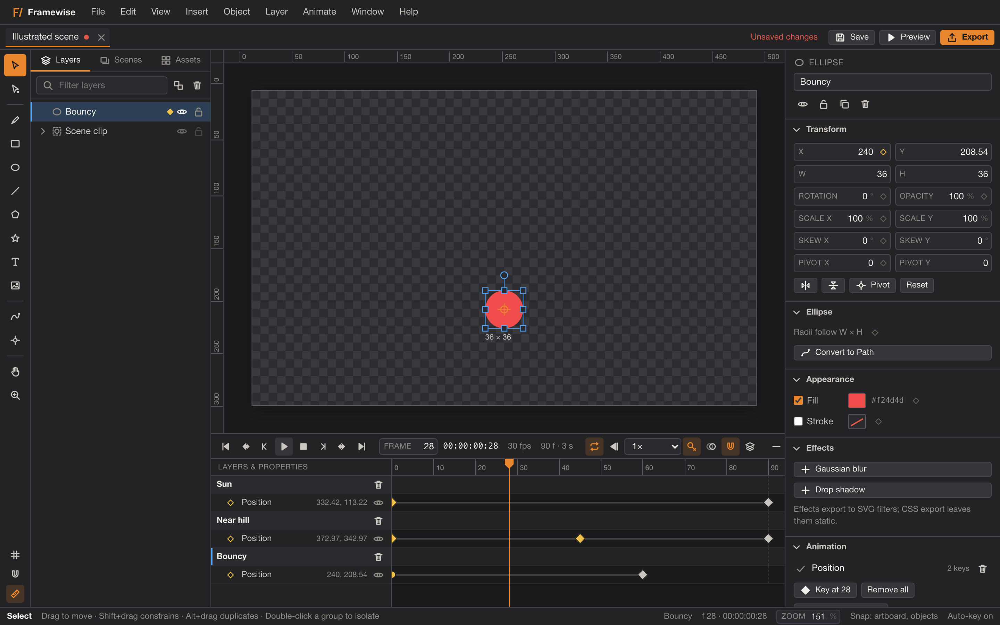
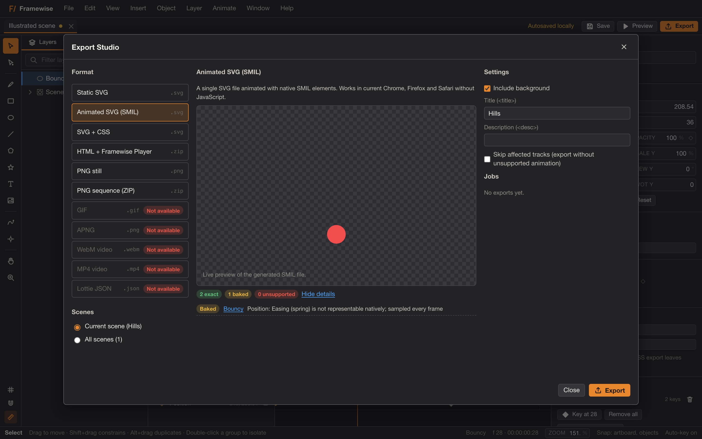
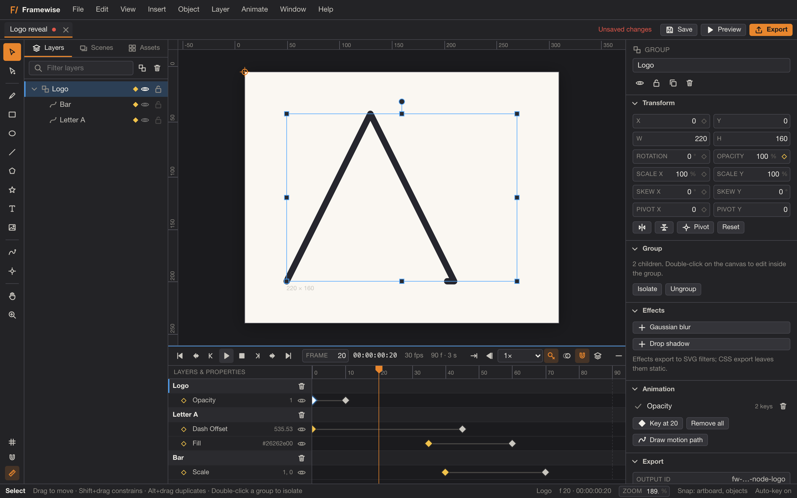

# Framewise

Framewise is an open-source vector animation editor that runs in the browser. You draw or import SVG, animate layers on a keyframe timeline, keep the editable `.framewise` file on your own machine, and export animated SVG, CSS, an HTML player bundle or PNG frames. There is no account, no server and no telemetry.

Live build: https://vheissu.github.io/framewise/



## What it does

- Draws rectangles, ellipses, lines, polygons, stars, text and Bézier paths, with direct anchor editing, groups, clip groups, lock, hide, reorder and isolation.
- Imports SVG through a sanitiser into editable layers, with a review that lists what was kept, approximated or dropped. Imports PNG, JPEG and WebP as image layers.
- Animates position, scale, rotation, skew, pivot, opacity, visibility, fill and stroke colour, stroke width, dash offset, rectangle size and corner radius, ellipse radii, compatible path morphs, font size, text content, blur and progress along a motion path.
- Keyframes sit on integer frames with exact rational frame rates (29.97 is 30000/1001). Easing is hold, linear, the CSS presets, overshoot presets, editable cubic Bézier curves or a closed-form spring. Auto-keyframe adds a frame-0 baseline so the start of an animation never jumps.
- Plays once, repeats or ping-pongs, at adjustable speed, forwards or in reverse, with onion skin and a full-screen preview that uses the same evaluator as the exports.
- Autosaves to the browser, offers recovery copies after an interrupted session, and saves `.framewise` ZIP archives. Chromium browsers write back to the file you chose; others get a download.
- Exports static SVG, animated SVG (SMIL), SVG + CSS, a standalone HTML player bundle, PNG stills and PNG sequences. Every export shows a per-track report of what is exact, baked or unsupported before you download.



## What it does not do

Being clear about this is part of the design, so the Export Studio lists these as unavailable rather than hiding them:

- GIF, APNG, WebM and MP4 encoding. Export a PNG sequence and run it through ffmpeg or a similar tool.
- Lottie or dotLottie. No adapter has been verified against an independent player.
- Symbols (reusable instanced components), path boolean operations, outline stroke, patterns, masks and markers.
- Multi-line text layout. Text is a single run and depends on the fonts installed where the file is viewed.
- Collaboration, cloud storage, plugins.

## Browser support

Current Chrome, Edge, Firefox and Safari on desktop. Saving back to an existing file needs the File System Access API (Chromium); elsewhere each save downloads a new file. The app installs as a PWA and works offline once cached. Tablets can open and preview documents; precise editing expects a pointer and keyboard.

## Running it

```bash
pnpm install --frozen-lockfile
pnpm run dev
```

Checks, in the order CI runs them:

```bash
pnpm run typecheck
pnpm run lint
pnpm run format:check
pnpm run elm:test
pnpm run test:unit
pnpm run test:e2e        # pnpm exec playwright install first
pnpm run build
pnpm run preview
```

The production build is static files. `FRAMEWISE_BASE=/framewise/ pnpm run build` produces the GitHub Pages layout; `.github/workflows/release.yml` deploys it on every push to `main`.



## How it is built

Elm 0.19.3 owns the document, the editor state and the single animation evaluator that the canvas, the preview and every exporter read from. TypeScript handles the parts the browser only exposes through JavaScript: IndexedDB, ZIP archives, file pickers, SVG sanitising, rasterising and download packaging. The two sides talk through one validated port protocol, and the HTML player is a separate 400-line runtime checked against the Elm evaluator with shared golden fixtures.

- `docs/architecture.md`: module layout, bridge protocol, persistence model.
- `docs/animation-model.md`: time, tracks, easing, auto-keyframe, motion paths.
- `docs/file-format.md`: the `.framewise` archive and `document.json`.
- `docs/export-compatibility.md`: the per-format capability table.
- `docs/security.md`: how imported SVG and archives are handled.
- `SPECIFICATION.md`: the full product specification this implementation follows.

## Privacy

Documents stay in your browser's storage and in files you save. The app makes no network requests after loading itself, loads no remote fonts and reports nothing anywhere. Browsers can evict site storage, so save `.framewise` files for work you want to keep.

## Licence

MIT. See `THIRD_PARTY_NOTICES.md` for the two runtime dependencies (DOMPurify and fflate) and the Elm packages.
